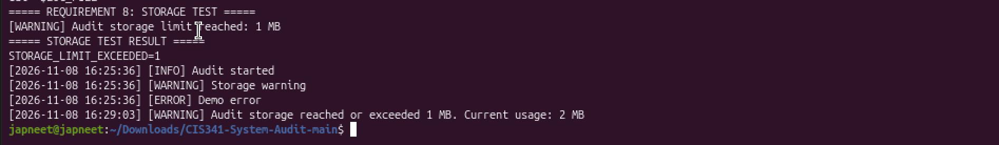
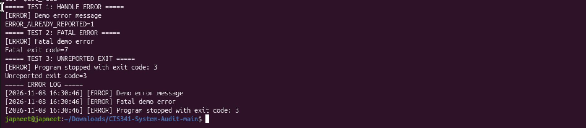

# CIS341-System-Audit
CIS 341 Group Project - System Health Monitor &amp; Security Auditing Daemon


## Project Overview

The System Health Monitor & Security Auditing Daemon is a Linux-based project developed using Bash scripting. It helps monitor system activity, manage audit files, and check storage usage.

The project uses an external configuration file to manage system settings. It also supports command-line options, logging, automated cleanup, and error handling. This module manages audit file compression, archive cleanup, and archive statistics using Bash scripting. It contains three main functions and a scheduler to perform archive maintenance.

## CLI Help Menu (Requirement 1)

The main script, `sysaudit.sh`, includes a help menu that explains how to use the program.

To display the help menu:

```bash
bash sysaudit.sh --help
```

The help menu includes:
- Program usage and command syntax.
- Available command-line options.
- Examples of how to run the script.
- Configuration settings and their descriptions.
- Exit codes and error descriptions.

Available command-line options:
- `-h`, `--help` - Display the help menu.
- `--storage-limit NUMBER` - Override the storage limit in MB.
- `--scan-interval NUMBER` - Override the scan interval in seconds.
- `--daemon` - Run the continuous monitoring loop.
- `--delegate USER` - Request user delegation.
- `--revoke USER` - Request removal of delegated access.
- `--list-delegates` - Display delegated users.

The help menu was tested using `bash sysaudit.sh --help`.


### Installation (Requirement 2)

Run the helper as root from the project directory:

```bash
sudo ./install_sysaudit.sh
```

The installer:
- Creates the `auditmanager` user if it does not exist and installs the `acl` package if `setfacl` is missing.
- Creates `/course_project/audit` (mode 750) and `/opt/sysaudit`, and the log file `/var/log/sysaudit_daemon.log` (mode 640), all owned by `auditmanager`.
- Copies the scripts and `sysaudit.cfg` into `/opt/sysaudit`.
- Installs the systemd units, reloads systemd, and enables the service and timer.

Verify with `systemctl status sysaudit.service sysaudit.timer`.


**Scheduled Audit File Compression (Requirement 3)**

The project includes a scheduled audit file compression function that manages raw audit files using Bash scripting.
The function compress_audit_files() is implemented in Bandhna.K.sh.The function performs the following operations:

Searches for .audit files in the configured audit directory.
Uses the find command to locate audit files.
Compresses audit files into .tar.gz archives using the tar command.
Generates unique archive filenames using the current date and time.
Deletes original audit files only after successful compression.
Records compression activities and results in the system log.

The scheduler, BK_scheduler.sh, checks the configured archive interval and calls the compression function during scheduled maintenance.

**Compression Testing**

The compression function was tested using a sample demo.audit file.The test confirmed that:

The audit file was successfully detected.
A .tar.gz archive was created.
The archive contents were verified using the tar -tzf command.
The original audit file was deleted after successful compression.

## External Configuration File (Requirement 4)

The project uses an external file named `sysaudit.cfg` to store system settings. The main script reads this file when it starts.

The configuration file includes:

- `AUDIT_DIR` - Directory used to store audit files.
- `ARCHIVE_DIR` - Directory used to store compressed archives.
- `LOG_FILE` - Path for the system log file.
- `RAW_FILE_EXTENSION` - Extension for audit reports.
- `ARCHIVE_EXTENSION` - Extension for compressed files.
- `SCAN_INTERVAL_SECONDS` - Time between scans in seconds.
- `STORAGE_LIMIT_MB` - Storage warning limit in MB.
- `ARCHIVE_INTERVAL_DAYS` - Interval for archive maintenance.
- `ARCHIVE_HOUR` - Hour used for scheduled maintenance.
- `RETENTION_DAYS` - Number of days to keep archived files.
- `AUTHORIZED_USER` - Account authorized to run the program.

Settings can be updated in `sysaudit.cfg` without changing the main script.

The script also checks for missing or invalid configuration values.


### Requirement 5: Logging

**Implementation File:** `logging.sh`

The logging module records system audit activities with timestamps and severity levels.

The following functions are implemented:

- `log_info()` – Records informational messages.
- `log_warning()` – Records warning messages.
- `log_warn()` – Provides an alias for warning messages.
- `log_error()` – Records error messages.
- `_write_log()` – Creates the log directory when needed and appends timestamped messages to the configured log file.

**Testing:**

The logging module was tested by generating INFO, WARNING, and ERROR messages. The output confirmed that messages were recorded with timestamps and the correct severity levels.


**Automated Archive Cleanup (Requirement 6)**

The project includes an archive cleanup function that automatically removes expired compressed archives.The function delete_old_archives() is implemented in Bandhna.K.sh.The function performs the following operations:

Uses the configured retention period of 14 days.
Searches for compressed .tar.gz archive files.
Uses file modification time to identify archives older than the retention period.
Deletes expired archives using the rm command.
Keeps newer archive files.
Records cleanup activities in the system log.

**Archive Cleanup Testing**

The cleanup function was tested using sample archive files.The test confirmed that:

An archive dated 16 days earlier was identified as expired.
The expired archive was successfully deleted.
A newer archive remained in the archive directory.

**Core Metadata Audit Summary Logging (Requirement 7)**

The project includes an archive statistics function that collects information about compressed audit archives.The function show_archive_statistics() is implemented in Bandhna.K.sh.The function performs the following operations:

Counts the total number of compressed archives.
Identifies the largest compressed archive.
Displays the exact filename of the largest archive.
Calculates the exact size of the largest archive in bytes.
Retrieves the archive's modification timestamp.
Writes archive statistics to the configured log file.

**Archive Statistics Testing**

The statistics function was tested using the project test archive directory.The test confirmed that:

The total number of compressed archives was displayed.
The largest archive filename was identified.
The exact archive size in bytes was calculated.
The modification timestamp was displayed.
All statistics were successfully recorded in the test log.

**Scheduled Archive Maintenance**

The file BK_scheduler.sh coordinates the archive maintenance functions.The scheduler performs the following operations:

Loads the external configuration file sysaudit.cfg.
Loads the logging functions from logging.sh.
Loads the Member 2 functions from Bandhna.K.sh.
Checks the configured three-day archive maintenance interval.
Executes compression, archive cleanup, and archive statistics.
Updates the scheduler state after successful maintenance.
Records maintenance activities in the scheduler log.

**Scheduler Testing**

The scheduler was executed successfully in test mode using:
TEST_MODE=1 bash BK_scheduler.sh

The test confirmed that:
The scheduler started successfully.

All three maintenance functions were called.

Archive statistics were generated.

The maintenance completion message was displayed.

Scheduler activities were recorded in member2_cron.log.


### Requirement 8: Storage Monitoring and Warnings

**Implementation File:** `storage_check.sh`

The storage monitoring module checks the disk space used by the audit directory and compares it against the configured storage limit.

The implementation includes:

- Checks whether the audit directory exists.
- Validates the configured storage limit.
- Measures directory usage using `du -sk`.
- Converts the configured MB limit into KB.
- Compares current storage usage against the configured limit.
- Logs an informational message when storage is within the limit.
- Displays and logs a warning when storage reaches or exceeds the limit.
- Sets `STORAGE_LIMIT_EXCEEDED=1` when the limit is reached or exceeded.

The configured storage threshold in `sysaudit.cfg` is `STORAGE_LIMIT_MB=100`.

**Testing:**

The storage module was tested using a temporary 2 MB file and a 1 MB storage threshold. The test successfully displayed a storage warning and set `STORAGE_LIMIT_EXCEEDED=1`.

**Screenshot – Implementation and Testing:**



---


## CLI Overrides (Requirement 9)

The script reads default settings from `sysaudit.cfg`. Command-line arguments can override selected settings for the current execution without changing the configuration file.

### Storage Limit Override

The default storage limit in `sysaudit.cfg` is 100 MB.

```bash
bash sysaudit.sh --storage-limit 50
```

This command overrides the storage limit to 50 MB for that execution.

### Scan Interval Override

The default scan interval in `sysaudit.cfg` is 60 seconds.

```bash
bash sysaudit.sh --scan-interval 30
```

This command overrides the scan interval to 30 seconds for that execution.

### Input Validation

The script checks command-line inputs and rejects invalid values.

For example:

```bash
bash sysaudit.sh --storage-limit abc
```

This displays an error message and returns exit code 1.

Both CLI overrides were verified using Bash debugging output.

## Installation, systemd and Permissions (Requirements 2, 11, 12)


### Requirement 10: Error Handling

**Implementation File:** `error_handler.sh`

The error-handling module manages unexpected errors and program termination.

The following functions are implemented:

- `handle_error()` – Displays and logs error messages.
- `fatal_error()` – Handles critical errors and exits with a non-zero status.
- `handle_exit()` – Detects unreported non-zero exit statuses.
- `handle_signal()` – Handles interruption signals such as SIGINT and SIGTERM.
- `install_error_traps()` – Installs traps for EXIT, INT, and TERM signals.

The `ERROR_ALREADY_REPORTED` flag helps prevent duplicate error messages.

**Testing:**

The error-handling module was tested using normal error reporting, fatal error handling, and an unreported program exit. The tests confirmed that error messages were displayed and logged, and that the expected exit codes were returned.

**Screenshot – Implementation and Testing:**



---


### systemd Service (Requirement 11)

`systemd/sysaudit.service` runs `sysaudit.sh --daemon` as `auditmanager` with `Restart=on-failure`. Exit codes 2, 3 and 4 are not retried. Hardening options: `NoNewPrivileges`, `PrivateTmp`, `ProtectHome`, `ProtectSystem=strict`, and `ReadWritePaths` limited to the audit directory and log file.

`systemd/sysaudit.timer` triggers `sysaudit-cleanup.service` (which runs `BK_scheduler.sh`) at midnight every third day.

### User Permissions and Delegation (Requirement 12)

`security.sh` calls `enforce_identity` on every start. Only the account named in `AUTHORIZED_USER` may run the program; anyone else is rejected with exit code 2 and the attempt is written to the log and to syslog (`logger`).

Access to the audit workspace can be delegated with POSIX ACLs:

```bash
./sysaudit.sh --delegate auditor1     # grant read/write access
./sysaudit.sh --list-delegates        # show delegated users
./sysaudit.sh --revoke auditor1       # remove access
```

Delegation is refused for invalid usernames, the current user, `root`, and users that do not exist.

### Deployment and Security Test Screenshots

Screenshots of the systemd deployment and security testing are in `docs/deployment_security_ss/`:
- Service and timer running as `auditmanager`
- Identity check rejecting an unauthorized user (exit code 2)
- Delegation: grant, list and revoke

## System Architecture 

The diagram below shows the main components of the System Health Monitor and Security Auditing Daemon. It includes the main script, configuration file, system monitoring modules, continuous scanning, audit reports, and archive maintenance.


## Automated Testing (Requirement 13)

This project includes an automated testing script named 'test_sysaudit.sh' which was developed using bash scripting. This automated script tests different functions of the System Health and Monitoring Daemon to check that they verify that they function.

### Features Tested

This test scripts covers 29 automated tests covering key functions:

- Configuration file validation and other command-line options
- Logging functions and error handling
- Audit file compression and archive cleanup
- Storage monitoring and warnings for storage limit
- Scheduler and other maintenance tasks
- Security checks and restrictions on user authorization

### How to Run the Automated Tests

To run the automated tests, you execute them in the project directory in Linux using 

``` bash
bash test_sysaudit.sh
```

Each test implemented will either display a [PASSED] or [FAILED] option depending on whether the expected result was satisified

### Testing Results

All 29 tests passed successfully, and 0 failures during the final test

These tests verify specific scenarios and functions for this project, we tried to test every possible scenario as much as possible.

### Challenges 

While we were testing a problem we encountered was when team members would update their scripts, there was a Windows/Linux line-ending compatibility issues which caused majority of the tests to display [FAILED]. We resolved them by running 'dos2unix'

Another issue for example that we ran into was when the scheduler script was updated, we had to change the scheduler's updated success message in order for the test to pass.

  ## Logging, Storage Monitoring, and Error Handling

---


### Challenges

During implementation and testing, the following challenges were addressed:

- Ensuring log messages were recorded with timestamps and correct severity levels.
- Measuring storage usage and comparing it against the configured storage limit.
- Handling unexpected errors and termination signals.
- Preventing duplicate error messages during error handling.
- Testing the interaction between logging and error-handling functions.
